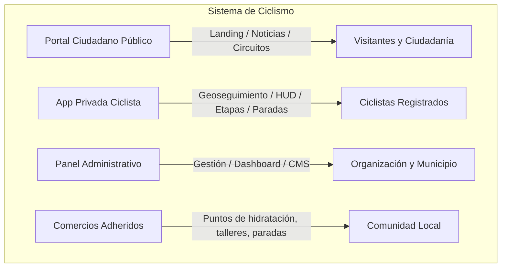

# 🚴‍♂️ Sistema de Gestión y Movilidad de Ciclismo Municipal

Bienvenido al baúl de documentación y especificación técnica de la plataforma de ciclismo. Este sistema está diseñado para gestionar, monitorear y visibilizar la movilidad de ciclistas en circuitos turísticos y deportivos del municipio, integrando a los vecinos, ciclistas, comercios locales y administradores municipales.

---

## 🗺️ Mapa de Contenidos (MOC)

Explore los módulos y especificaciones técnicas detalladas a través de los siguientes documentos interconectados:

1. **[[01 - Arquitectura y Stack Tecnologico]]**
   - Definición del stack tecnológico (Django 4.2 LTS / 5.0, MySQL 8.0, Leaflet.js, DRF).
   - Justificación de compatibilidad con cPanel (Phusion Passenger, PyMySQL) sin requerir librerías C nativas (GeoDjango/GDAL).
   - Estructura completa de carpetas y distribución de responsabilidades.

2. **[[02 - Modelo de Datos]]**
   - Especificación detallada de entidades: Circuitos, Subcircuitos, Puntos de Tramo, Comercios Adheridos, Recorridos, Registros GPS y Noticias.
   - Diagrama Entidad-Relación (ERD) en Mermaid.
   - Diccionario de datos y restricciones de precisión decimal (`DecimalField`).

3. **[[03 - Modulo Ciudadano y App Ciclista]]**
   - Portal Público / Landing (`index.html`): visualización de circuitos, noticias, catálogo comercial y formulario de contacto.
   - Navegación e Identidad Institucional (`header_ciudadano.html`): Logotipo oficial ampliado con subrayado continuo verde institucional (`#2e7d32`) y botón "Ingresar" alineado a la derecha en la barra de navegación.
   - Directorio Público y Detalle de Comercios (`/comercios/` y `/comercio/<pk>/`): Catálogo filtrable por categorías, buscador en vivo, Hero panorámico y mapa interactivo con Google Maps nativo (iframe y botón directo a navegación GPS "Cómo llegar").
   - Portal de Noticias Oficiales (`/noticias/` y `/noticia/<pk>/`): Rediseño con Hero oscuro institucional, muro de novedades por categorías y ficha de lectura optimizada sin métricas de visitas públicas.
   - Inscripción Oficial de Ciclistas (`/contacto/`): Formulario de registro municipal con generación de código `CIC-XXX` y estado inicial `Pendiente` para evaluación de la organización.
   - Autenticación Ciclista (`/login/`): login optimizado para móviles y acceso ágil para ciclistas.
   - Mini Panel de Control (`/mi-progreso/`): KPIs 2x2, gráfico Donut radial de avance total, inscripción con dorsal, cronograma de paradas (timeline en 2 columnas sin solapamientos) y mini mapa.
   - Mapa de Carrera en Vivo (`/mapa-carrera/`): mapa fullscreen con Leaflet (OSM HOT oficial de Malagueño), HUD deportivo de alta visibilidad, píldora superior de etapa activa, stepper segmentado, Drawer/Bottom Sheet interactivo de subcircuitos y alertas de transición entre etapas.

4. **[[04 - Modulo Panel de Administracion]]**
   - Dashboard en tiempo real con KPIs ejecutivos, gráficos de actividad y accesos directos responsive.
   - Gestión integral de Ciclistas con botones de decisión rápida de admisión (*Validar* / *Rechazar*) en tabla y ficha técnica.
   - Gestión de Comercios Adheridos con geolocalización interactiva Leaflet y radio de tolerancia circular.
   - Diseñador y trazador interactivo de etapas/subcircuitos (`editor_circuito.html`) con cálculo de distancias en vivo y adhesión granular de comercios a etapas.
   - CMS de Noticias con control de estados (*Publicado*, *Borrador*, *Archivado*), dropzone multimedia y previsualización.

5. **[[05 - Estrategia GPS y Algoritmos]]**
   - Estrategia de captura offline-first en navegador móvil (`watchPosition` + buffer local).
   - Envío por lotes (Batching a `/api/gps/batch/`) para optimización de I/O en cPanel.
   - Algoritmo de Haversine en Python/JS para distancias acumuladas y validación de comercios.
   - Algoritmo de detección y transición automática entre subcircuitos / etapas secuenciales.

6. **[[06 - Plan Maestro de Implementacion]]**
   - Plan secuencial de ejecución por fases (Fases 1 a 7 completadas al 100%, 56 tests automáticos pasando con éxito y entorno preparado para cPanel).

---

## 🎯 Resumen Ejecutivo de Objetivos

- **Capa Pública:** Difusión del circuito, novedades municipales, visualización de comercios y vías de contacto.
- **Capa Deportiva/Ciclista:** Registro de actividad física, velocidad, cronometraje, validación automática de paso por comercios, tracking por subcircuitos / etapas secuenciales y visualización de progreso.
- **Capa de Gestión Municipal:** Control en tiempo real del evento, métricas agregadas de participación y trazado de etapas.
