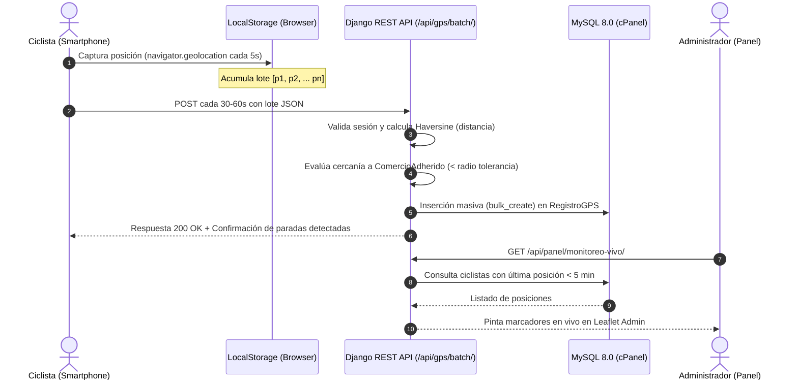

# 🏛️ Arquitectura del Sistema y Stack Tecnológico

Este documento describe la arquitectura global, las tecnologías seleccionadas y la justificación técnica de diseño para asegurar máxima estabilidad, bajo consumo de recursos en servidores compartidos/cPanel y una excelente experiencia en dispositivos móviles.

---

## 💻 Stack Tecnológico Principal

| Capa / Módulo | Tecnología / Herramienta | Razón de Selección y Decisiones de Diseño |
| :--- | :--- | :--- |
| **Backend Framework** | **Django 4.2 LTS / 5.0** (Python 3.10+) | Estructura MVC/MVT madura, panel de administración robusto, ORM seguro y soporte nativo en cPanel mediante **Phusion Passenger**. |
| **Base de Datos** | **MySQL 8.0** | Motor de base de datos relacional estándar provisto en entornos cPanel. Se modelan coordenadas con `DecimalField(9, 6)` sin necesidad de instalar extensiones espaciales C nativas. |
| **Driver de Base de Datos** | **PyMySQL** (`pymysql.install_as_MySQLdb()`) | Driver Python puro que evita dependencias de compilación en C (`mysqlclient`), simplificando el despliegue en entornos compartidos. |
| **Capa de APIs** | **Django REST Framework (DRF)** | Endpoints JSON serializados y ligeros para consumo de coordenadas en tiempo real, mapas públicos y sincronización por lotes (*batching*). |
| **Motor de Mapas Frontend** | **Leaflet.js** (v1.9+) | Librería JavaScript ultraliviana (~42 KB gzip), altamente compatible con dispositivos móviles, sin consumo excesivo de memoria ni batería. |
| **Capa Oficial de Mapas (Tiles)** | **OpenStreetMap Humanitarian (HOT)** | `https://{s}.tile.openstreetmap.fr/hot/{z}/{x}/{y}.png`. Capa oficial adoptada por el Municipio de Malagueño (mismo proveedor que en su portal de obras públicas). Libre de bloqueos HTTP 403, sin marcas de agua de "API KEY REQUIRED" y con alto contraste para vialidad y senderos. |
| **Geolocalización Móvil** | **HTML5 Geolocation API** | Uso de `navigator.geolocation.watchPosition` con `enableHighAccuracy: true` para captura precisa de ubicación nativa del ciclista. |
| **Almacenamiento Local** | **HTML5 Web Storage (localStorage)** | Buffer temporal en el navegador que almacena los registros GPS offline para tolerar microcortes de conectividad antes del envío en lote. |
| **Estilos e Interfaz** | **Vanilla CSS + JS Mobile-First** | Control total de estilos sin dependencias pesadas de frameworks CSS externos, optimizando los tiempos de carga (FCP/LCP) en redes 4G/3G. Tipografía institucional *Outfit* e *Inter*. |

---

## ⚙️ Consideraciones Críticas de Infraestructura (cPanel & Passenger)

### 1. Ausencia de GeoDjango / GDAL
- Los servidores cPanel compartidos generalmente **no permiten** instalar bibliotecas C complejas como `GDAL`, `GEOS` o `PROJ`, indispensables para GeoDjango / PostGIS.
- **Solución implementada:** Se utilizan campos estándar `DecimalField(max_digits=9, decimal_places=6)` y algoritmos de trigonometría esférica (**Fórmula de Haversine**) ejecutados directamente en Python (`utils.py`). Esto provee precisión métrica (< 1 metro) sin dependencias externas.

### 2. Inicialización de PyMySQL
En el archivo de configuración `core/settings.py` (o en `core/wsgi.py`), se asegura la compatibilidad antes de cargar el ORM:
```python
import pymysql
pymysql.install_as_MySQLdb()
```

### 3. Dependencias de Python (`requirements.txt`)
```text
Django>=4.2.14,<5.1
PyMySQL>=1.1.2
Pillow>=10.4.0
python-dotenv>=1.0.1
djangorestframework>=3.14.0
```

---

## 📂 Estructura General del Proyecto

El sistema se divide limpiamente en dos aplicaciones de negocio principales (`ciudadano` y `panel`), gestionadas por un núcleo de configuración (`core`):

```text
nombre_del_proyecto/
│
├── core/                         # Configuración general de Django
│   ├── __init__.py
│   ├── asgi.py
│   ├── settings.py               # Configuración DB MySQL cPanel, STATICFILES_DIRS, etc.
│   ├── urls.py                   # Enrutador principal (incluye urls de ciudadano y panel)
│   └── wsgi.py                   # Punto de entrada para Phusion Passenger en cPanel
│
├── ciudadano/                    # APP 1: Área pública (Landing) y experiencia privada del Ciclista
│   ├── migrations/
│   ├── templates/
│   │   └── ciudadano/            # Vistas específicas del portal público y app ciclista
│   │       ├── index.html        # Landing con mapa del circuito activo, noticias y contacto
│   │       ├── noticia_detalle.html
│   │       ├── login.html        # Formulario de ingreso para ciclistas
│   │       ├── mapa_carrera.html # Vista de carrera con GPS activo para el ciclista
│   │       └── mi_progreso.html  # Avance por subcircuitos y paradas realizadas
│   ├── __init__.py
│   ├── admin.py
│   ├── apps.py
│   ├── context_processors.py     # Inyección global de datos de circuito o noticias
│   ├── models.py                 # Circuito, SubCircuito, PuntosTramo, Comercio, Recorrido, RegistroGPS, Noticia
│   ├── urls.py                   # Rutas públicas y endpoints API de tracking
│   ├── utils.py                  # Funciones auxiliares (ej. cálculo de distancia Haversine)
│   └── views.py                  # Lógica de renderizado e ingesta de coordenadas
│
├── panel/                        # APP 2: Panel de gestión administrativa
│   ├── templates/
│   │   └── panel/                # Vistas específicas de administración
│   │       ├── dashboard.html    # Métricas y mapa global de ciclistas activos
│   │       ├── ciclistas_list.html
│   │       ├── ciclista_form.html
│   │       ├── comercios_list.html
│   │       ├── comercio_form.html
│   │       ├── circuitos_list.html
│   │       ├── circuito_form.html
│   │       ├── subcircuitos_gestion.html # Diseñador de tramos y secuencias de puntos
│   │       └── noticias_list.html
│   ├── __init__.py
│   ├── apps.py
│   ├── forms.py                  # Formularios Django para carga de comercios, noticias y usuarios
│   ├── urls.py                   # Rutas /panel/...
│   └── views.py                  # Vistas basadas en clases (CBV) para gestión CRUD
│
├── static/                       # Archivos estáticos
│   ├── css/
│   │   ├── footers/              # footer_ciudadano.css
│   │   ├── headers/              # header_ciudadano.css
│   │   └── pages/                # home.css, noticias.css, contacto.css, login.css, progreso.css, mapa_carrera.css
│   ├── IMG/                      # Logo institucional Malagueño, marcadores y fotos
│   ├── js/
│   │   ├── ciudadano/            # mapa_publico.js, mapa_carrera_gps.js, mini_mapa_progreso.js
│   │   └── panel/                # Scripts de administración y trazador interactivo Leaflet
│   └── video/                    # Video institucional para el banner Hero
│
├── templates/                    # Plantillas base de la raíz (Layouts compartidos)
│   ├── base/                     # base_ciudadano.html, base_login.html, base_panel.html
│   ├── footers/                  # Fragmentos modulares de pie de página
│   ├── headers/                  # Fragmentos modulares de encabezado
│   └── includes/                 # Componentes reutilizables (sidebar_panel, modal_parada)
│
├── media/                        # Archivos subidos por el admin (imágenes noticias, locales)
├── venv/                         # Entorno virtual Python
├── .env                          # Variables de entorno (Credenciales DB cPanel, Secret Key)
├── manage.py
└── requirements.txt              # Especificación de paquetes pip
```

---

## 🔄 Flujo de Datos y Separación de Responsabilidades



---

## 🔗 Documentos Relacionados
- [[00 - Indice del Sistema]]
- [[02 - Modelo de Datos]]
- [[03 - Modulo Ciudadano y App Ciclista]]
- [[04 - Modulo Panel de Administracion]]
- [[05 - Estrategia GPS y Algoritmos]]
- [[06 - Plan Maestro de Implementacion]]
