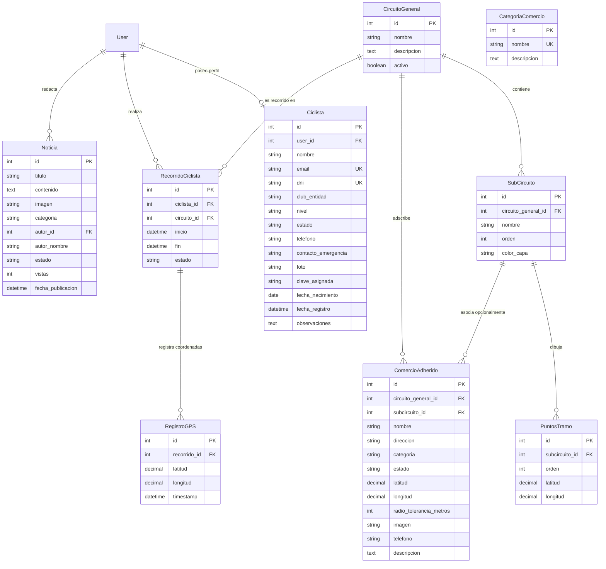

# 🗄️ Modelo de Datos y Esquema Técnico

Este documento detalla el diseño relacional del sistema implementado a través del ORM de Django en la aplicación `ciudadano/models.py`. Se optimizó para operar sobre **MySQL 8.0** sin requerir bibliotecas geoespaciales nativas como PostGIS o GeoDjango/GDAL.

---

## 📊 Diagrama Entidad-Relación (ERD)

---

## 📋 Diccionario de Entidades y Modelos

### 1. `CircuitoGeneral`
Representa el evento general o circuito maestro de la ciudad (ej: *"Reto Urbano Malagueño 2026"*).
- **`nombre`**: `CharField(max_length=150)` - Título del circuito.
- **`descripcion`**: `TextField(blank=True)` - Detalles del circuito, recomendaciones y reglamento.
- **`activo`**: `BooleanField(default=False)` - Flag booleano que determina cuál es el circuito activo visible en la landing pública (`index.html`) y en la app ciclista.

> [!IMPORTANT]
> **Arquitectura de Subcircuitos:** Un `CircuitoGeneral` **no posee un trazado monolítico directo**, sino que está conformado obligatoriamente por una secuencia de **`SubCircuito`s (etapas)** ordenados cronológicamente (`orden`). La suma ordenada de estos subcircuitos conforma la distancia total del evento y permite monitorear el progreso granular del ciclista (Etapa 1 -> Etapa 2 -> Etapa 3).

### 2. `SubCircuito`
Subdivisiones o etapas que componen un circuito general (ej: *"Etapa 1: Circuito Histórico y Casco Céntrico"*, *"Etapa 2: Ruta de las Canteras y Ciclovía"*, *"Etapa 3: Desafío de las Sierras Chicas"*).
- **`circuito_general`**: `ForeignKey(CircuitoGeneral, related_name='subcircuitos', on_delete=models.CASCADE)` - Circuito maestro al que pertenece.
- **`nombre`**: `CharField(max_length=150)` - Nombre identificador de la etapa.
- **`orden`**: `PositiveIntegerField(default=1)` - Posición o correlatividad de la etapa en la carrera. Determina el flujo obligatorio de la carrera.
- **`color_capa`**: `CharField(max_length=7, default='#FF0000')` - Código hexadecimal (ej. `#10b981`, `#f59e0b`, `#3b82f6`) para pintar su trazado individual en Leaflet y colorear las tarjetas/steppers del ciclista.

### 3. `PuntosTramo`
Secuencia ordenada de coordenadas geográficas (`Polyline`) que componen el trazado físico de un subcircuito específico.
- **`subcircuito`**: `ForeignKey(SubCircuito, related_name='trazado', on_delete=models.CASCADE)` - Subcircuito al cual pertenece este punto.
- **`orden`**: `PositiveIntegerField()` - Posición ordinal del punto en la polilínea del subcircuito.
- **`latitud`**: `DecimalField(max_digits=9, decimal_places=6)` - Coordenada latitudinal (-90 a 90).
- **`longitud`**: `DecimalField(max_digits=9, decimal_places=6)` - Coordenada longitudinal (-180 a 180).

> [!NOTE]
> **Cálculo de Distancia por Subcircuito:** A partir de los `PuntosTramo` ordenados de cada subcircuito, el backend ejecuta `calcular_distancia_total_puntos()` mediante la fórmula de Haversine para obtener los kilómetros exactos de cada etapa y el kilometraje total acumulado del circuito sin necesidad de almacenar redundancias.

### 4. `ComercioAdherido`
Puntos de interés, sponsors o locales comerciales del municipio adheridos al evento (hidratación, talleres mecánicos, gastronomía, hospedaje).
- **`circuito_general`**: `ForeignKey(CircuitoGeneral, related_name='comercios', on_delete=models.SET_NULL, null=True, blank=True)` - Circuito principal.
- **`subcircuito`**: `ForeignKey(SubCircuito, related_name='comercios', on_delete=models.SET_NULL, null=True, blank=True)` - Vinculación granular opcional a una etapa específica del recorrido.
- **`nombre`**: `CharField(max_length=150)` - Nombre del local o punto de servicio.
- **`direccion`**: `CharField(max_length=200, blank=True)` - Domicilio o referencia urbana en Malagueño.
- **`categoria`**: `CharField(max_length=50, choices=CATEGORIAS)` - Categorías: `Restauración`, `Taller de Bicicletas`, `Tienda Deportiva`, `Alojamiento`, `Punto de Hidratación`, `Punto de Control`, `Otro`.
- **`estado`**: `CharField(max_length=20, choices=ESTADOS)` - `Activo`, `En Revision`, `Inactivo`.
- **`latitud`**: `DecimalField(max_digits=9, decimal_places=6)`
- **`longitud`**: `DecimalField(max_digits=9, decimal_places=6)`
- **`radio_tolerancia_metros`**: `IntegerField(default=30)` - Radio en metros a la redonda para considerar que el ciclista ha visitado/registrado parada en el comercio.
- **`imagen`**: `ImageField(upload_to='comercios/', null=True, blank=True)` - Logotipo o fotografía del establecimiento.
- **`telefono`**: `CharField(max_length=40, blank=True)` - Vía de comunicación telefónica o WhatsApp.
- **`descripcion`**: `TextField(blank=True)` - Reseña comercial, promociones y beneficios para deportistas.

### 5. `RecorridoCiclista`
Sesión de carrera o entrenamiento de un usuario ciclista registrado.
- **`ciclista`**: `ForeignKey(User, on_delete=models.CASCADE, related_name='recorridos')` - Usuario autenticado (`django.contrib.auth.models.User`).
- **`circuito`**: `ForeignKey(CircuitoGeneral, on_delete=models.CASCADE, related_name='recorridos_realizados')` - Circuito sobre el cual se realiza la actividad.
- **`inicio`**: `DateTimeField(auto_now_add=True)` - Marca temporal de inicio de carrera.
- **`fin`**: `DateTimeField(null=True, blank=True)` - Marca temporal de finalización.
- **`estado`**: `CharField(max_length=20, default='EN_CURSO')` - Estados posibles:
  - `EN_CURSO` (carrera activa emitiendo GPS)
  - `PAUSADO` (recorrido en pausa temporal)
  - `FINALIZADO` (carrera concluida)

### 6. `RegistroGPS`
Cada una de las posiciones geográficas reportadas por el dispositivo del ciclista durante el recorrido.
- **`recorrido`**: `ForeignKey(RecorridoCiclista, related_name='puntos', on_delete=models.CASCADE)`
- **`latitud`**: `DecimalField(max_digits=9, decimal_places=6)`
- **`longitud`**: `DecimalField(max_digits=9, decimal_places=6)`
- **`timestamp`**: `DateTimeField()` - Momento exacto de captura del punto por el GPS.

### 7. `Noticia`
Publicaciones informativas, avisos de seguridad y comunicados emitidos por la administración municipal.
- **`titulo`**: `CharField(max_length=200)` - Titular del comunicado.
- **`contenido`**: `TextField()` - Redacción completa de la noticia.
- **`imagen`**: `ImageField(upload_to='noticias/', null=True, blank=True)` - Fotografía de portada.
- **`categoria`**: `CharField(max_length=60, choices=CATEGORIAS)` - Temáticas: `Urbanismo`, `Seguridad`, `Comunidad`, `Eventos`, `Oficial`.
- **`autor`**: `ForeignKey(User, on_delete=models.SET_NULL, null=True, blank=True, related_name='noticias')` - Usuario del sistema que publicó la noticia.
- **`autor_nombre`**: `CharField(max_length=120, blank=True)` - Nombre público del redactor o área de prensa municipal.
- **`estado`**: `CharField(max_length=20, choices=ESTADOS)` - `Publicado`, `Borrador`, `Archivado`.
- **`vistas`**: `PositiveIntegerField(default=0)` - Contador acumulativo de lecturas registradas.
- **`fecha_publicacion`**: `DateTimeField(auto_now_add=True)` - Fecha y hora de emisión.
- **Propiedades auxiliares:**
  - `autor_display`: Resuelve dinámicamente la firma pública visible (prioriza `autor_nombre`, luego nombre y apellido del usuario o fallback `"Admin Ciclo"`).
  - `estado_badge_class`: Clase CSS cromática para badges del panel administrativo.

### 8. `Ciclista`
Participante registrado o acreditado en la plataforma de ciclismo municipal para el evento o competencias.
- **`user`**: `OneToOneField(User, on_delete=models.SET_NULL, null=True, blank=True, related_name='perfil_ciclista')` - Cuenta de usuario para autenticación (opcional o vinculable).
- **`nombre`**: `CharField(max_length=150)` - Nombre y apellido completo del participante.
- **`email`**: `EmailField(unique=True)` - Dirección de correo electrónico única.
- **`dni`**: `CharField(max_length=25, unique=True)` - Documento Nacional de Identidad o pasaporte.
- **`club_entidad`**: `CharField(max_length=120, default="Independiente")` - Equipo, agrupación deportiva o participación libre.
- **`nivel`**: `CharField(max_length=20, choices=NIVELES)` - Nivel competitivo: `Aficionado`, `Pro`, `Elite`.
- **`estado`**: `CharField(max_length=20, choices=ESTADOS, default='Pendiente')` - Estados del flujo de admisión:
  - `Pendiente`: Inscripción inicial recibida desde el portal público (`/contacto/`). Espera validación del equipo organizador.
  - `Validado`: Participante admitido oficialmente con dorsal y acceso habilitado para correr.
  - `Rechazado`: Solicitud declinada por inconsistencia de datos o cupo.
- **`telefono`**: `CharField(max_length=40, blank=True)` - Teléfono móvil de contacto.
- **`contacto_emergencia`**: `CharField(max_length=150, blank=True)` - Nombre y número telefónico de emergencia médica.
- **`foto`**: `ImageField(upload_to='ciclistas/', null=True, blank=True)` - Fotografía de perfil o credencial.
- **`fecha_registro`**: `DateTimeField(auto_now_add=True)` - Marca de tiempo de registro.
- **`observaciones`**: `TextField(blank=True)` - Historial médico, notas de aptitud física o documentación.
- **Propiedades auxiliares:**
  - `codigo_id`: Formatea el identificador con prefijo oficial institucional (ej: `CIC-001`, `CIC-024`).

---

## ⚡ Recomendaciones de Optimización e Índices

Para garantizar máxima velocidad en consultas de alta concurrencia:
1. **Índice compuesto en `RegistroGPS`:** `['recorrido', 'timestamp']` para acelerar la reconstrucción del trazado y el orden temporal.
2. **Índice compuesto en `PuntosTramo`:** `['subcircuito', 'orden']` para ordenar la polilínea del circuito de forma instantánea al serializar el JSON del mapa.
3. **Índice en `CircuitoGeneral`:** `['activo']` para recuperar el circuito en curso en la landing con tiempo $O(1)$.

---

## 🔗 Documentos Relacionados
- [[00 - Indice del Sistema]]
- [[01 - Arquitectura y Stack Tecnologico]]
- [[03 - Modulo Ciudadano y App Ciclista]]
- [[04 - Modulo Panel de Administracion]]
- [[05 - Estrategia GPS y Algoritmos]]
