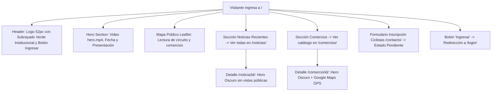
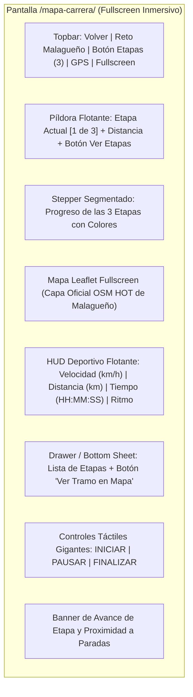

# 🚴 Módulo Ciudadano y App Móvil del Ciclista

Este módulo comprende tanto la experiencia pública de cara a la comunidad (portal informativo) como la experiencia autenticada del deportista/ciclista en ruta.

---

## 🌐 1. Área Pública Ciudadana (`index.html`)

Diseñada para ser 100% responsiva (mobile-first), accesible sin registro ni inicio de sesión y con alto impacto visual.

### Componentes de la Experiencia Pública Ciudadana

1. **Header y Navegación Unificada (`header_ciudadano.html` y `header_ciudadano.css`):**
   - **Logotipo Institucional Prominente:** Escudo y tipografía municipal con altura de `52px` para máximo impacto y legibilidad.
   - **Subrayado Institucional Verde Corporativo:** Barra inferior verde continua (`#2e7d32`, `height: 3px`) trazada con precisión justo debajo del texto *"MUNICIPALIDAD DE MALAGUEÑO"*, respetando la identidad visual oficial.
   - **Navegación Alineada y Coherente:** Todos los enlaces principales (*Inicio*, *Circuitos*, *Comercios*, *Noticias*, *Inscripción*) y la acción de ingreso se encuentran agrupados en la barra derecha con idéntico espaciado (`gap: 1.75rem`).
   - **Botón "Ingresar":** Integrado armónicamente en el menú (reemplazando el antiguo *"Ir a Carrera"*), con estética de botón verde corporativo (`.btn-ingresar-header`), sombras suaves y redirección directa hacia `/login/`.

2. **Sección Hero:**
   - Reproductor multimedia con `video/hero.mp4` o banner fotográfico de alta resolución.
   - Contador regresivo / fecha del evento activo, título del circuito e instrucciones iniciales.

3. **Mapa Interactivo del Circuito Activo (Modo Lectura):**
   - Renderizado con Leaflet.js (`mapa_publico.js`).
   - Carga dinámica del circuito marcado como `activo=True` vía API REST.
   - Capas coloreadas según el `color_capa` de cada `SubCircuito`.
   - Marcadores personalizados con íconos temáticos según la categoría del comercio (hidratación 💧, taller 🔧, gastronomía 🍔).
   - **No solicita permisos de GPS:** Vista informativa pura, ligera y optimizada.

4. **Directorio y Detalle Público de Comercios Adheridos (`/comercios/` y `/comercio/<pk>/`):**
   - **Listado y Catálogo (`comercios_listado.html`):**
     - Hero institucional con buscador reactivo por nombre, dirección o categoría.
     - Píldoras de filtrado temático (*Todos*, *Restauración*, *Taller*, *Tienda Deportiva*, *Alojamiento*, *Punto de Hidratación*).
     - Grilla responsiva de tarjetas comerciales con foto/logo, categoría con badge temático, radio de tolerancia y enlace directo al detalle.
   - **Ficha de Detalle Comercial (`comercio_detalle.html`):**
     - **Hero Oscuro Panorámico:** Cabecera con imagen de fondo fotográfica de alta resolución y superposición degradada institucional (`linear-gradient(rgba(11,56,30,0.85), rgba(15,23,42,0.95))`).
     - **Logo Destacado:** Imagen oficial o logotipo del comercio en tarjeta circular/flotante con borde blanco y sombra pronunciada.
     - **Información y Servicios:** Dirección, categoría, teléfono con botón de llamada directa (`tel:`), circuito asociado y beneficios/promociones para los ciclistas.
     - **Integración con Google Maps Nativo:** Mapa embebido interactivo mediante `<iframe>` centrado en las coordenadas geográficas exactas del local (`latitud`, `longitud`), complementado con botón destacado **"Cómo llegar en Google Maps"** que abre la aplicación de mapas oficial en el celular para navegación GPS paso a paso.

5. **Portal de Noticias Oficiales (`/noticias/` y `/noticia/<pk>/`):**
   - **Muro de Novedades (`noticias_listado.html`):**
     - Vista especial pública con publicaciones oficiales del municipio.
     - Píldoras de filtrado (*Urbanismo*, *Seguridad*, *Comunidad*, *Eventos*, *Oficial*), buscador y paginación.
     - Grilla de tarjetas con imagen destacada, fecha y autor. Eliminado el contador de visitas públicas para una lectura visualmente limpia y periodística.
   - **Detalle de Noticia (`noticia_detalle.html`):**
     - **Hero Oscuro con Gradiente Institucional:** Título, categoría, fecha y firma de autor enmarcados sobre fondo panorámico oscuro con degradado envolvente.
     - **Cuerpo Editorial:** Redacción tipográfica optimizada para lectura relajada, citas destacadas y enlace de retorno al listado.

6. **Formulario de Inscripción Oficial de Ciclistas (`/contacto/` e `/inscripcion/` - `contacto.html`):**
   - **Ficha Técnica de Registro:** Formulario oficial para aspirantes a participantes con campos validados: Nombre y Apellido, DNI / Documento, Correo Electrónico (Gmail / institucional), Teléfono Celular, Contacto de Emergencia Médica, Club o Entidad Deportiva (*Independiente* por defecto), Nivel competitivo (*Aficionado*, *Pro*, *Elite*), Observaciones/Condiciones Médicas y **Foto Carnet / Imagen de Perfil**.
   - **Foto Carnet Normalizada:** Carga de imagen carnet con previsualización circular reactiva. El archivo se normaliza automáticamente (minúsculas, sin espacios ni caracteres especiales) y se almacena en `media/ciclistas/`.
   - **Validación Estricta sin Duplicados:** Verificación bidireccional contra `Ciclista` y `User` para impedir DNI o correos electrónicos repetidos, preservando los datos ingresados ante cualquier error.
   - **Rutas Unificadas:** Disponible tanto en `/contacto/` como en el acceso directo `/inscripcion/`.
   - **Estado Inicial 'Pendiente':** La inscripción se persiste inmediatamente en base de datos asignando un código oficial correlativo (`CIC-001`, `CIC-002`, etc.) y fijando su estado de admisión como **`Pendiente`**.
   - **Conexión Directa con el Panel Municipal:** La solicitud impacta de forma automática en el listado de ciclistas del panel (`/panel/ciclistas/`), donde el personal municipal dispone de un modal interactivo para **Aprobar y Dar de Alta** (asignando clave) o **Rechazar** (eliminando definitivamente el registro e imagen física).
   - **Canales de Atención Institucionales:** Sede municipal (Av. San Martín 450), líneas de emergencia (Defensa Civil 103, Deportes) y mini mapa interactivo.

---

## 📱 2. Plataforma Privada del Ciclista

Diseñada para operar como una **Web App deportiva moderna** orientada a manubrio de bicicleta y visibilidad bajo luz solar directa.

### A. Autenticación Oficial (`/login/`)
- **Diseño Visual Institucional:** Pantalla de acceso limpia con los colores oficiales de Malagueño (Verde `#0b381e` y Dorado `#eab308`), fondo sutil con siluetas deportivas y escudo municipal.
- **Acceso Flexible por DNI o Gmail:** El participante puede ingresar indistintamente con su **Correo Electrónico (Gmail)** o con su **DNI / Documento**, junto con la contraseña provista por la administración municipal.
- **Validación Estricta de Admisión:**
  - Si la inscripción está en estado **`Pendiente`**, el sistema lo detecta y muestra un aviso: *"Tu solicitud de inscripción aún está en estado PENDIENTE de revisión municipal"*.
  - Si la solicitud fue **`Rechazada`**, se le informa oportunamente impidiendo el acceso a la carrera.
  - Si está **`Validado`**, inicia sesión oficial con Django (`django.contrib.auth.login`) y es redirigido a [`/mi-progreso/`](/mi-progreso/).
- **Persistencia de Sesión:** Mantiene activa la sesión del ciclista durante todo el evento para impedir deslogueos accidentales por vibración o baches en el manubrio.

### B. Mini Panel del Ciclista (`/mi-progreso/`)
El centro de control post-login donde el ciclista monitorea su estado y su inscripción al evento:

1. **Hero del Ciclista y Gráfico Donut SVG:**
   - Saludo personalizado con el nombre del usuario y su nivel deportivo (*Nivel: Ciclista Urbano Pro*).
   - **Donut Chart SVG Radial:** Gráfico circular de alta precisión que calcula el porcentaje total acumulado (`stroke-dashoffset`) con tipografía centrada.
2. **Barra de Acción Rápida (Inscripción / Largada):**
   - Si no está inscripto: botón para inscribirse con confirmación inmediata.
   - Si está inscripto: muestra su dorsal oficial asignado (ej: **#0024**) y el botón táctil directo **"Iniciar Recorrido GPS"** / **"Continuar Recorrido en Vivo"**.
3. **KPIs en Cuadrícula 2x2:**
   - 4 tarjetas deportivas con iconografía temática: **Distancia Acumulada** (km), **Velocidad Media** (km/h), **Tiempo en Ruta** y **Puntos Validados**.
4. **Mis Sub-circuitos (Etapas):**
   - Listado de tarjetas de cada subcircuito del circuito activo, indicando porcentaje completado, cantidad de checkpoints validados y estado (*Completado*, *En Curso*, *Pendiente*).
5. **Cronograma de Paradas (Timeline Vertical de 2 Columnas):**
   - Diseñado con arquitectura Flexbox en 2 columnas independientes:
     - **Columna 1 (Nodos):** Círculo indicador con ícono + hilo conductor continuo (`::after`).
     - **Columna 2 (Contenido):** Título de la parada, dirección, tipo de servicio y badge de estado.
   - Resuelve el problema de solapamiento de textos e íconos en celulares angostos (≤ 360px).
6. **Mini Mapa Embebido:** Vista previa del circuito para inspección rápida de la ruta.

---

### C. Mapa de Carrera en Vivo (`/mapa-carrera/`)

La pantalla central durante la competición. Su principio fundamental es que **un circuito está conformado por subcircuitos o etapas secuenciales**:

#### Funcionalidades Clave de la Pantalla de Carrera:
1. **Capa Oficial de Mapas sin Bloqueos:**
   - Utiliza la capa oficial **OpenStreetMap Humanitarian (HOT)** (`https://{s}.tile.openstreetmap.fr/hot/{z}/{x}/{y}.png`), la misma que utiliza el portal de obras de Malagueño, garantizando disponibilidad sin errores HTTP 403 ni carteles de cobro de API Keys.
2. **Píldora Flotante de Subcircuito Activo y Stepper:**
   - Informa en todo momento: *Etapa 1 de 3 - Circuito Histórico y Casco Céntrico* con el color oficial de la etapa.
   - Stepper segmentado con animación de pulso que llena visualmente el tramo a medida que se avanza.
3. **Drawer / Bottom Sheet de Subcircuitos:**
   - Panel desplegable que se abre desde el botón `Etapas (3)` o desde la píldora.
   - En móviles se despliega desde abajo (Bottom Sheet) para ser operado con una sola mano.
   - Permite tocar **"Ver Tramo en Mapa"** en cualquier etapa para centrar el mapa (`fitBounds`) en esa porción del circuito.
4. **HUD de Telemetría Deportiva de Alta Visibilidad:**
   - Tarjeta flotante con valores en tipografía gigante y nítida bajo luz solar directa.
   - **Velocidad actual:** km/h en vivo.
   - **Distancia:** Kilómetros recorridos acumulados.
   - **Cronómetro:** Tiempo transcurrido con formato `HH:MM:SS`.
   - **Ritmo medio:** Velocidad promedio ponderada.
5. **Banner de Transición y Avance de Etapa:**
   - Cuando el ciclista completa una etapa e ingresa al siguiente subcircuito, el sistema lanza una alerta animada en pantalla (*¡Etapa 1 Completada! Iniciando Etapa 2: Ruta de las Canteras*) acompañada de vibración háptica.
6. **Detección de Comercios Adheridos:**
   - Notificación emergente al ingresar dentro del radio de tolerancia (30m) de un local registrado con beneficios, agua o asistencia mecánica.
7. **Simulador de Desarrollo Multietapa:**
   - Modo de pruebas integrado que emula el avance real del ciclista a 22 km/h por todas las etapas de Malagueño para validar la telemetría sin requerir desplazamiento físico.

---

## 🎨 Guía de Estilos y Estructura CSS

La interfaz de usuario se organiza en hojas de estilo modulares:
- `static/css/headers/header_ciudadano.css`: Navbar institucional fixed con backdrop blur.
- `static/css/footers/footer_ciudadano.css`: Footer municipal y canales de contacto.
- `static/css/pages/home.css`: Layout del hero, grilla de noticias, mapa público y contacto.
- `static/css/pages/login.css`: Login responsive institucional con card flotante.
- `static/css/pages/noticias.css`: Estilos de listado y detalle de noticias con Hero oscuro panorámico.
- `static/css/pages/comercios.css`: Catálogo de comercios, cards con badges, y detalle con Google Maps.
- `static/css/pages/progreso.css`: KPIs 2x2, gráfico Donut, timeline en 2 columnas y cards de subcircuitos.
- `static/css/pages/mapa_carrera.css`: Modo fullscreen, HUD de telemetría, píldora de subcircuito, stepper segmentado, drawer bottom-sheet y controles táctiles gigantes.

---

## 🔗 Documentos Relacionados
- [[00 - Indice del Sistema]]
- [[01 - Arquitectura y Stack Tecnologico]]
- [[02 - Modelo de Datos]]
- [[04 - Modulo Panel de Administracion]]
- [[05 - Estrategia GPS y Algoritmos]]
- [[06 - Plan Maestro de Implementacion]]
