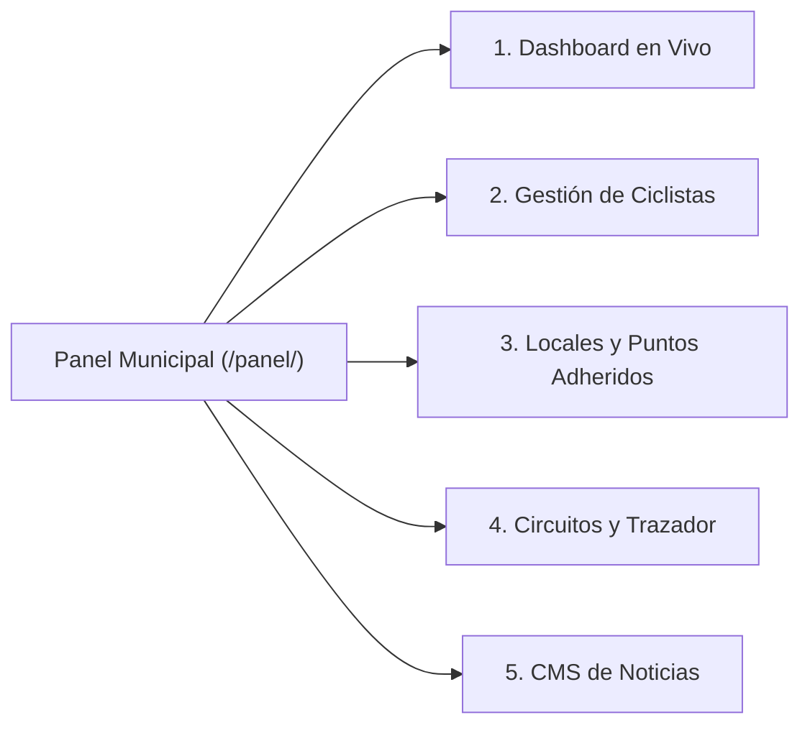
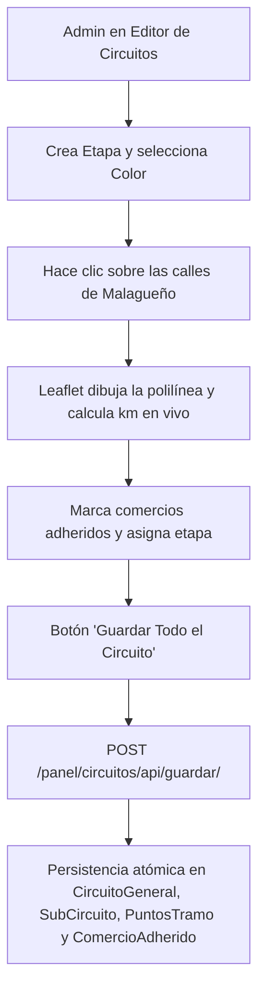

# 🛠️ Módulo Panel de Administración (Gestión Municipal)

El panel administrativo (`panel/`) está orientado al equipo operativo municipal y organizadores del evento. Proporciona control integral sobre los participantes, la infraestructura de la carrera, los comercios asociados y el monitoreo en tiempo real.

---

## 🧭 Estructura y Navegación del Panel

El panel utiliza una arquitectura de plantillas modulares (`base_panel.html`) con una barra lateral fija (`includes/sidebar_panel.html`) y encabezado con estado del sistema (`headers/header_panel.html`).

---

## 📈 1. Dashboard General (`dashboard.html`)

El centro de operaciones y resumen ejecutivo del sistema municipal:

- **Estructura Visual Institucional:**
  - **Encabezado:** Banner institucional con fondo verde oscuro (`#0b381e`), badge "Gestión Municipal", título "Panel de Control" y saludo al administrador.
  - **Tarjetas de KPIs Principales (4 métricas):**
    - **Participantes Totales:** Ciclistas registrados con tasa de crecimiento (+12.5%).
    - **Circuitos Activos:** Rutas y etapas habilitadas actualmente (+2).
    - **Comercios Aliados:** Red comercial y puntos de abastecimiento activos (+4.2%).
    - **Kilómetros Totales:** Distancia comunitaria acumulada (-2.1%).
  - **Gráfico de Área "Participación Semanal":** Curvas continuas con gradientes verde y dorado comparando usuarios inscritos vs. ciclistas con actividad real, con indicador pulsante *En Vivo*.
  - **Grilla Intermedia Bipolar:**
    - **Actividad Reciente:** Feed cronológico de eventos con distintivos de estado y timestamps dinámicos.
    - **Impacto Comercial Local:** Gráfico de barras horizontales verdes que categoriza consumos en Cafetería, Repuestos, Ropa, Eventos y Otros.
  - **Accesos Rápidos (4 módulos clave):**
    - *Gestión de Usuarios* (verificación de registros).
    - *Control de Circuitos* (edición de rutas y puntos en tiempo real).
    - *Red de Comercios* (validación de establecimientos y promociones).
    - *Reportes Avanzados* (análisis de KPIs mensuales).

> [!IMPORTANT]
> **Comportamiento Responsive de Accesos Rápidos:**  
> Por requerimiento operativo, la sección de **Accesos Rápidos** se ubica al final de la página en versión de escritorio (`order: 5`), pero en dispositivos móviles se reordena automáticamente al principio (`order: 2`), justo debajo del encabezado de bienvenida. Esto permite a los administradores en calle acceder directamente a las operaciones clave sin scroll excesivo.

---

## 👥 2. Gestión de Ciclistas (`gestion_ciclistas/`)

Ubicación de plantillas: `panel/templates/panel/gestion_ciclistas/`

- **`listado_ciclistas.html`:**
  - Encabezado con título, descripción y botones de acción (*Exportar CSV* y *+ Nuevo Ciclista*).
  - Tarjetas de KPIs: *Total Registrados*, *Pendientes Validación*, *Activos Hoy* y *Nuevos (7 Días)*.
  - Tabla completa con búsqueda en tiempo real (por Nombre, DNI, Email, Club o ID) y filtro selector por estado (*Validado*, *Pendiente*, *Rechazado*).
  - Columnas: `ID`, `Ciclista` (Avatar + Nombre + Email), `DNI / Documento`, `Club / Entidad`, `Nivel`, `Estado` y `Acciones`.
  - **Botones y Modal de Acreditación / Alta:** Para los participantes en estado `Pendiente`, la columna de acciones presenta:
    - **Validar (Botón verde con check):** Abre un **Modal Interactivo de Alta** donde el personal municipal visualiza el DNI y Gmail del ciclista, pudiendo ingresar una contraseña manual o pulsar un botón para generar una clave aleatoria (ej: `MuniXXXX!`). Al confirmar, el sistema crea/activa el usuario `User` de Django (`username=DNI`, `email=Gmail`, `password=clave`), vincula `ciclista.user = user`, establece `estado = 'Validado'` y muestra las credenciales completas para facilitarle el acceso al ciclista.
    - **Rechazar (Botón rojo con cruz):** Descarta y rechaza la postulación eliminando definitivamente el registro del ciclista de la base de datos y suprimiendo físicamente su foto carnet de `media/ciclistas/`.
    - Ejecuta un POST seguro contra la vista atómica `panel_ciclista_cambiar_estado`.
- **`form_ciclistas.html`:**
  - Formulario multipropósito para **Crear**, **Ver** (ficha técnica), **Editar** y **Eliminar** participantes.
  - **Banner de Resolución Administrativa (Modo Lectura / Ficha):** Si el participante se encuentra en estado `Pendiente`, la ficha técnica exhibe un banner institucional destacado con alerta y botones de acción directa (*Aprobar Solicitud* con apertura del modal de credenciales / *Rechazar*).
  - Campos: Nombre y Apellido, Correo Electrónico, DNI, Teléfono, Contacto de Emergencia, Club/Entidad, Nivel (`Aficionado`, `Pro`, `Elite`), Estado (`Pendiente`, `Validado`, `Rechazado`), Foto de Perfil y Observaciones.
  - Modal seguro para confirmación de eliminación definitiva.
- **Rutas asociadas:**
  - `/panel/ciclistas/` (Listado y filtros)
  - `/panel/ciclistas/nuevo/` (Creación)
  - `/panel/ciclistas/<id>/` (Ficha técnica modo lectura con banner de decisión)
  - `/panel/ciclistas/<id>/editar/` (Edición completa)
  - `/panel/ciclistas/<id>/eliminar/` (Eliminación)
  - `/panel/ciclistas/<id>/cambiar-estado/<nuevo_estado>/` (Acción atómica de cambio rápido de estado: Validado / Rechazado)
  - `/panel/ciclistas/exportar-csv/` (Descarga de archivo CSV)

---

## 🏪 3. Gestión de Comercios (`gestion_comercios/`)

Ubicación de plantillas: `panel/templates/panel/gestion_comercios/`

- **`listado_comercios.html`:**
  - Encabezado con título *"Gestión de Comercios"*, subtítulo explicativo y botones de acción (*Filtrar* y *+ Nuevo Comercio*).
  - Tarjetas de KPIs (con iconos temáticos e indicadores de color):
    - **Total Comercios:** Conteo global de establecimientos adheridos (icono verde de tienda).
    - **Activos:** Locales en funcionamiento visible para la comunidad ciclista (icono verde check).
    - **En Revisión:** Nuevas solicitudes pendientes de validación municipal (icono ámbar lápiz).
    - **Inactivos:** Establecimientos pausados o deshabilitados (icono rojo cruz).
  - Buscador rápido en tiempo real por Nombre, Dirección o Categoría.
  - Tabla de Establecimientos con diseño institucional:
    - **Comercio:** Nombre en negrita principal y Dirección/Domicilio en tipografía secundaria.
    - **Categoría:** Badge estilizado verde pastel (*Restauración*, *Taller de Bicicletas*, *Tienda Deportiva*, *Alojamiento*, *Punto de Hidratación*, etc.).
    - **Ubicación (Lat, Long):** Coordenadas geográficas con precisión decimal estándar.
    - **Radio:** Margen de proximidad y tolerancia de detección en metros (ej: `30m`, `50m`).
    - **Estado:** Píldora de estado (*Activo*, *En Revisión*, *Inactivo*).
    - **Acciones:** Menú contextual rápido para Ver Ficha, Editar y Eliminar establecimiento.
- **`form_comercios.html`:**
  - Formulario multipropósito para **Crear**, **Ver** (ficha técnica con datos deshabilitados), **Editar** y **Eliminar**.
  - **Selector Geográfico Interactivo (Leaflet):**
    - Mapa centrado en las coordenadas del comercio con marcador arrastrable y actualizador al hacer clic.
    - Círculo de cobertura georreferenciado que se expande o contrae dinámicamente según el valor ingresado en el campo *Radio de Tolerancia (metros)*.
    - Sincronización bidireccional entre mapa e inputs numéricos de latitud y longitud.
  - **Gestor de Logo e Imagen Representativa:**
    - Dropzone interactivo de carga con drag-and-drop y previsualización en tiempo real (`FileReader`).
    - Almacenamiento físico en `media/comercios/`.
    - **Normalización automática del nombre de archivo:** Todo en minúsculas, espacios reemplazados por guión bajo `_` y supresión de caracteres especiales o tildes (ej: `Mi Café & Bici (1).PNG` ➔ `mi_cafe_bici_1.png`).
    - **Reemplazo limpio:** Al subir un nuevo logo, el archivo previo se elimina automáticamente del disco físico (`media/comercios/`), evitando acumulación de archivos huérfanos.
    - **Eliminación limpia:** Al eliminar un comercio, su imagen física asociada es borrada del disco.
  - Campos: Nombre del Establecimiento, Dirección, Categoría, Estado Operativo, Radio de Detección, Teléfono de Contacto, Coordenadas (Lat/Long), Logo/Imagen del comercio y Descripción/Beneficios para ciclistas.
  - Modal seguro para confirmación de eliminación definitiva.
- **Rutas asociadas:**
  - `/panel/comercios/` (Listado y búsqueda)
  - `/panel/comercios/nuevo/` (Alta de nuevo establecimiento)
  - `/panel/comercios/<id>/` (Ficha técnica y mapa interactivo)
  - `/panel/comercios/<id>/editar/` (Edición de parámetros y coordenadas)
  - `/panel/comercios/<id>/eliminar/` (Eliminación definitiva)

---

## 🗺️ 4. Gestión de Circuitos y Trazador de Etapas (`gestion_circuitos/`)

Ubicación de plantillas: `panel/templates/panel/gestion_circuitos/`

- **`listado_circuitos.html`:**
  - Encabezado con badge institucional y botón de acción principal *+ Nuevo Circuito*.
  - Tarjetas de KPIs:
    - **Total Circuitos:** Conteo global de recorridos registrados.
    - **Circuito Activo:** Nombre del circuito maestro actualmente publicado en la app para los ciclistas.
    - **Total Etapas:** Sumatoria de todos los subcircuitos creados.
    - **Comercios en Red:** Establecimientos vinculados a los circuitos municipales.
  - Tabla de Circuitos con visualización de:
    - *Circuito:* Nombre y descripción.
    - *Etapas / Subcircuitos:* Píldoras con código de color (`color_capa`) y orden secuencial.
    - *Comercios:* Cantidad de establecimientos adheridos al circuito.
    - *Estado:* Indicador pulsante *Activo en App* o *Inactivo*.
    - *Acciones:* Acceso directo al *Editor y Trazador*, botón de *Activar* y modal seguro de eliminación.

- **`editor_circuito.html` (Editor Todo-en-Uno estilo Google My Maps):**
  - **Arquitectura de Pantalla Dividida (Split-Screen):**
    - **Panel Lateral de Control (Izquierda):**
      - *Pestaña General:* Nombre del evento, descripción/reglamento y switch para activar como circuito oficial de la ciudad.
      - *Pestaña Etapas:* Creación dinámica de subcircuitos (`+ Agregar Nueva Etapa`), selector de color (hexadecimal), orden de secuencia, distancia en kilómetros calculada en tiempo real según los clics y botón pulsante *Trazar en Mapa*.
      - *Pestaña Comercios:* Listado de comercios existentes en Malagueño con checkboxes para adherirlos y selector desplegable para asociarlos opcionalmente a una etapa específica del recorrido.
      - *Footer:* Botón *Guardar Todo el Circuito* que envía el estado integral vía API atómica.
    - **Mapa Interactivo Leaflet (Derecha):**
      - Capa oficial **OpenStreetMap HOT** de Malagueño sin bloqueos ni dependencias externas.
      - Trazado de polilíneas punto a punto mediante clics directos sobre las calles de Malagueño.
      - Barra de herramientas flotante (*Deshacer Punto*, *Limpiar Tramo*, *Finalizar Trazo*).
      - Marcadores temáticos de comercios en el mapa que permiten adherir establecimientos con un solo clic.

- **Rutas asociadas:**
  - `/panel/circuitos/` (Listado y KPIs)
  - `/panel/circuitos/nuevo/` (Creación en editor interactivo)
  - `/panel/circuitos/<id>/editar/` (Edición de circuito, etapas y trazados existentes)
  - `/panel/circuitos/<id>/activar/` (Establecer como circuito oficial en la app ciclista)
  - `/panel/circuitos/<id>/eliminar/` (Eliminación definitiva)
  - `/panel/circuitos/api/guardar/` (API transaccional de guardado)

---

## 📰 5. Módulo de Noticias y Comunicados (`gestion_noticias/`)

Ubicación de plantillas: `panel/templates/panel/gestion_noticias/`
Hoja de estilos: `static/css/pages/panel_noticias.css`

- **`listado_noticias.html` (Fiel al diseño de referencia Visily):**
  - **Encabezado y Acción Principal:** Título institucional y botón `+ Nueva Noticia` con estilo verde corporativo.
  - **Fila de 4 Tarjetas de KPIs Horizontales:**
    - *Publicadas:* Conteo de artículos visibles para los ciudadanos con ícono check verde.
    - *Borradores:* Comunicados en preparación con ícono reloj ámbar.
    - *Lecturas Hoy:* Métricas de alcance y visualizaciones acumuladas con ícono ojo azul.
    - *Archivadas:* Artículos históricos con ícono papelera/archivo naranja.
  - **Barra de Herramientas y Filtros:**
    - *Pestañas tipo Pills:* Pestañas de estado rápido (*Todas*, *Publicadas*, *Borradores*, *Archivadas*) con estado activo sombreado.
    - *Buscador por Título:* Input con lupa e icono para limpiar búsqueda.
    - *Filtro Avanzado:* Botón de embudo que despliega selector de categorías temáticas (*Urbanismo*, *Seguridad*, *Comunidad*, *Eventos*, *Oficial*).
  - **Tabla de Noticias:**
    - *Imagen:* Thumbnail de 52x48 px con esquinas redondeadas y placeholder institucional fallback.
    - *Título:* Nombre del artículo con enlace directo a edición y debajo su identificador (`ID: X`).
    - *Categoría:* Píldora sutil gris con borde tenue.
    - *Autor:* Nombre del redactor o área de prensa municipal.
    - *Fecha:* Formato limpio de publicación (`d M Y`).
    - *Estado:* Badges cromáticos (*Publicado* verde, *Borrador* ámbar, *Archivado* gris).
    - *Acciones:* Dropdown de 3 puntos horizontales (`...`) con opciones: *Editar Noticia*, *Ver en Portal Público*, *Cambio Rápido de Estado* y *Eliminar* con modal seguro.
  - **Pie de Paginación:** Contador dinámico *"Mostrando X a Y de Z resultados"* y botones de paso *Anterior* / *Siguiente*.

- **`form_noticias.html` (Editor de Publicación):**
  - Layout dividido en 2 columnas (2fr contenido principal + 1fr sidebar de publicación).
  - **Columna Principal:** Título llamativo, selector de categoría, autor/redactor y área de contenido con contador en vivo de caracteres y palabras.
  - **Columna Lateral:**
    - *Panel de Publicación:* Selector de estado (*Publicado*, *Borrador*, *Archivado*), fecha y contador de lecturas acumuladas.
    - *Dropzone de Imagen:* Zona drag-and-drop con FileReader en vivo, selector de archivo y botón para remover la imagen existente.
  - **Barra de Acciones Inferior:** Botones *Guardar Borrador*, *Publicar Noticia / Guardar Cambios*, enlace a *Ver en Portal* y botón de *Eliminar Noticia* con confirmación modal.

- **Rutas asociadas:**
  - `/panel/noticias/` (Listado, KPIs, filtros por tab y búsqueda)
  - `/panel/noticias/nueva/` (Creación de nueva noticia con soporte multimedia)
  - `/panel/noticias/<id>/editar/` (Edición de contenido, estado e imagen)
  - `/panel/noticias/<id>/eliminar/` (Eliminación definitiva)
  - `/panel/noticias/<id>/estado/<nuevo_estado>/` (Cambio ágil de estado desde la tabla)

---

## 🔗 Documentos Relacionados
- [[00 - Indice del Sistema]]
- [[01 - Arquitectura y Stack Tecnologico]]
- [[02 - Modelo de Datos]]
- [[03 - Modulo Ciudadano y App Ciclista]]
- [[05 - Estrategia GPS y Algoritmos]]
