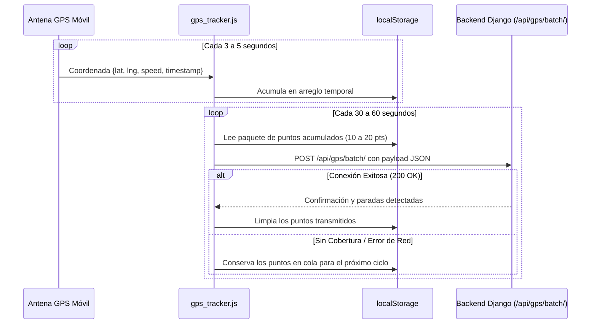
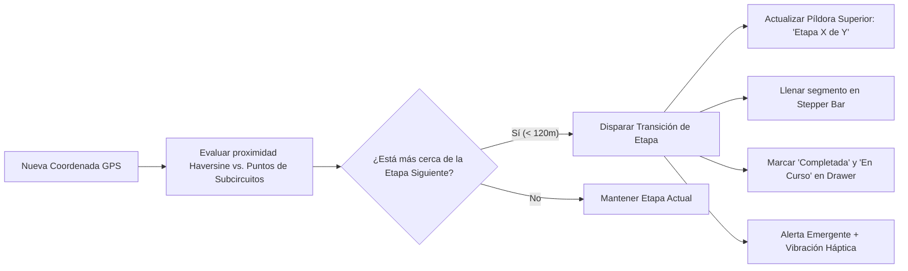

# 🛰️ Estrategia de Geolocalización y Algoritmos

Este documento define la arquitectura técnica para la ingesta de telemetría GPS masiva, el manejo de conectividad intermitente y el cálculo de métricas en Python sin depender de librerías C nativas.

---

## ⚡ El Desafío de Concurrencia en Servidores cPanel

Si 500 ciclistas transmitieran su coordenada por HTTP de forma individual cada segundo, el servidor recibiría **30.000 peticiones por minuto**. En un entorno compartido con **Phusion Passenger** y **MySQL 8.0**, esto provocaría:
- Agotamiento de los procesos/workers de Passenger (Error 503 / 504).
- Sobrecarga de transacciones y bloqueos de I/O en la base de datos.
- Drenaje acelerado de la batería y consumo de datos móviles de los ciclistas.

---

## 📦 Solución: Captura Local y Envío por Lotes (Batching)

La plataforma implementa un patrón **Offline-First con Buffer Local**:



### 1. Formato del Payload de Envío
```json
{
  "recorrido_id": 102,
  "puntos": [
    {
      "lat": -34.603722,
      "lng": -58.381592,
      "timestamp": "2026-10-19T10:00:00Z"
    },
    {
      "lat": -34.603810,
      "lng": -58.381650,
      "timestamp": "2026-10-19T10:00:10Z"
    }
  ]
}
```

---

## 🧮 Algoritmos en Backend (`ciudadano/utils.py`)

### 1. Fórmula Matemática de Haversine
Permite calcular la distancia ortodrómica (sobre la superficie de una esfera) entre dos puntos dadas sus latitudes y longitudes en radianes:

$$d = 2r \arcsin \left( \sqrt{\sin^2\left(\frac{\Delta \varphi}{2}\right) + \cos(\varphi_1) \cos(\varphi_2) \sin^2\left(\frac{\Delta \lambda}{2}\right)} \right)$$

Donde:
- $r = 6371000$ metros (radio medio de la Tierra).
- $\varphi_1, \varphi_2$ son las latitudes en radianes.
- $\Delta \varphi = \varphi_2 - \varphi_1$
- $\Delta \lambda = \lambda_2 - \lambda_1$

#### Implementación en Python Puro:
```python
import math

def calcular_distancia_metros(lat1, lon1, lat2, lon2):
    """Calcula la distancia en metros entre dos coordenadas usando Haversine."""
    R = 6371000.0  # Radio de la Tierra en metros
    phi1 = math.radians(float(lat1))
    phi2 = math.radians(float(lat2))
    delta_phi = math.radians(float(lat2) - float(lat1))
    delta_lambda = math.radians(float(lon2) - float(lon1))

    a = (math.sin(delta_phi / 2.0) ** 2 +
         math.cos(phi1) * math.cos(phi2) *
         math.sin(delta_lambda / 2.0) ** 2)
    c = 2.0 * math.atan2(math.sqrt(a), math.sqrt(1.0 - a))

    return R * c
```

---

## 📍 2. Algoritmo de Detección de Paradas en Comercios

Cuando el backend recibe el lote de puntos en `/api/gps/batch/`:
1. Recupera los `ComercioAdherido` asociados al circuito del recorrido actual (cacheados o consultados eficientemente).
2. Para cada nuevo punto recibido:
   - Comprueba la distancia hacia cada comercio.
   - Si $\text{distancia} \le \text{radio\_tolerancia\_metros}$ (ej: 30 metros), se registra la visita o parada.
3. Se devuelven en la respuesta HTTP las paradas validadas para que la app del ciclista active el modal visual (`modal_parada.html`).

---

## 💾 3. Persistencia Eficiente con `bulk_create`

Para no realizar una consulta `INSERT` por cada punto individual, el endpoint procesa todo el lote en una sola instrucción SQL:

```python
registros_a_crear = [
    RegistroGPS(
        recorrido=recorrido,
        latitud=p['latitud'],
        longitud=p['longitud'],
        timestamp=parse_datetime(p['timestamp'])
    )
    for p in puntos_validados
]
RegistroGPS.objects.bulk_create(registros_a_crear)
```

Esto reduce la carga de la base de datos MySQL en más de un **90%**, manteniendo tiempos de respuesta inferiores a **50 ms** por lote.

---

## 🏁 4. Algoritmo de Detección y Transición de Subcircuitos (Etapas)

Dado que un circuito está estructurado como una secuencia de subcircuitos (`SubCircuito`), el frontend y el backend deben reconocer en qué etapa se encuentra el ciclista y cuándo transiciona a la siguiente:



### Reglas del Algoritmo en Frontend (`mapa_carrera_gps.js`):
1. **Búsqueda del Punto más Cercano:** Para cada coordenada válida, se computa la distancia hacia los puntos de tramo del subcircuito activo y del subcircuito siguiente.
2. **Umbral de Cambio:** Si la distancia hacia el tramo de la etapa siguiente es inferior al umbral de tolerancia ($\le 120\text{ m}$) y el ciclista superó el final de la etapa previa, se ejecuta `actualizarEtapaActiva(nuevoIndex)`.
3. **Resaltado en Leaflet:** Se actualiza el grosor (`weight: 8`) y opacidad (`opacity: 1.0`) de la polilínea activa, atenuando las etapas completadas o pendientes (`weight: 5, opacity: 0.75`).
4. **Alerta y Háptica:** Se muestra un banner animado (*¡Etapa X Completada! Iniciando Etapa Y*) y se ejecuta `navigator.vibrate([250, 100, 250, 100, 400])`.

---

## 🚴 5. Simulador de Carrera Multietapa (Entorno de Desarrollo)

Para posibilitar el desarrollo y testeo continuo en entornos de oficina o PCs sin receptor GPS activo:
- El script construye una **ruta unificada** iterando en orden por las coordenadas de los subcircuitos 1, 2 y 3 de Malagueño.
- Un intervalo periódico (cada 2.5s) genera coordenadas con leve fluctuación gaussiana realista ($\pm 0.0002^\circ$) y velocidad simulada de $22.3\text{ km/h}$.
- Permite verificar visualmente la transición automática entre etapas, el cronómetro, la acumulación de kilometraje y el disparo de alertas de paradas sin necesidad de desplazarse físicamente.

---

## 🔗 Documentos Relacionados
- [[00 - Indice del Sistema]]
- [[01 - Arquitectura y Stack Tecnologico]]
- [[02 - Modelo de Datos]]
- [[03 - Modulo Ciudadano y App Ciclista]]
- [[04 - Modulo Panel de Administracion]]
- [[06 - Plan Maestro de Implementacion]]
