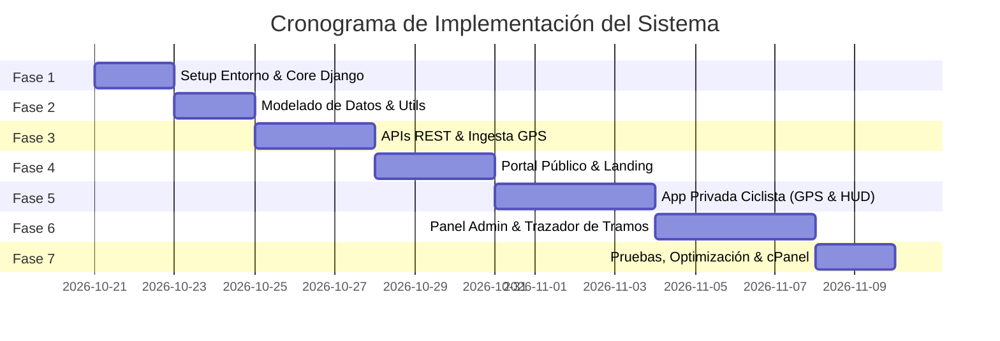

# 🚀 Plan Maestro de Implementación por Fases

Este plan de trabajo desglosa la construcción del **Sistema de Gestión y Movilidad de Ciclismo** en fases secuenciales, con entregables verificables y criterios de aceptación. Este documento permite evaluar, revisar y confirmar cada etapa antes de su ejecución.

---

## 🗺️ Visión General del Roadmap

---

## 📌 Detalle de Fases de Implementación

### 🔹 FASE 1: Configuración del Entorno, Core Django y Dependencias
*Objetivo:* Establecer el andamiaje base del proyecto asegurando compatibilidad con el entorno local y el servidor cPanel de producción.

- [x] **1.1 Configuración de entorno y paquetes:**
  - Creación del archivo `requirements.txt` con Django, PyMySQL, Pillow, python-dotenv y DRF.
  - Inicialización del entorno virtual `venv`.
- [x] **1.2 Inicialización del proyecto Django:**
  - Creación del proyecto `core` y las aplicaciones `ciudadano` y `panel`.
  - Configuración de `core/settings.py` con soporte para variables de entorno (`.env`), manejo de base de datos MySQL (con inicialización de PyMySQL) y fallback configurable para desarrollo local.
  - Configuración de directorios de plantillas (`templates/`), archivos estáticos (`static/`) y archivos multimedia (`media/`).
- **Criterio de Aceptación:** El servidor local corre sin advertencias con `python manage.py runserver` (verificado con `manage.py check` con 0 advertencias).

---

### 🔹 FASE 2: Modelado de Datos, Migraciones y Utilidades Matemáticas
*Objetivo:* Crear la estructura de persistencia en base de datos relacional y las librerías matemáticas para geolocalización.

- [x] **2.1 Implementación de modelos (`ciudadano/models.py`):**
  - `CircuitoGeneral`, `SubCircuito`, `PuntosTramo`.
  - `ComercioAdherido` (con coordenadas decimales y radio de tolerancia).
  - `RecorridoCiclista` y `RegistroGPS`.
  - `Noticia` con soporte para imágenes.
- [x] **2.2 Migraciones de Base de Datos:**
  - Generación y ejecución de migraciones iniciales (`makemigrations` y `migrate`).
  - Creación de índices compuestos para optimizar consultas de coordenadas.
- [x] **2.3 Utilidades Geoespaciales (`ciudadano/utils.py`):**
  - Función de distancia con la **Fórmula de Haversine** en Python puro.
  - Algoritmo de detección de paso por radio de tolerancia de comercios adheridos.
- **Criterio de Aceptación:** Pruebas unitarias ejecutadas con éxito (10 tests pasados en 1.8s) verificando cálculos de distancia, integridad de modelos y registro en admin.

---

### 🔹 FASE 3: APIs REST y Endpoints de Telemetría
*Objetivo:* Desarrollar los servicios web que alimentarán los mapas y recibirán la telemetría masiva de los ciclistas.

- [x] **3.1 Serializadores DRF:**
  - Serialización de circuitos y subcircuitos con sus secuencias de puntos ordenadas.
  - Serialización de comercios adheridos (con iconos y categorías).
  - Serializador de entrada para el lote de puntos GPS (`BatchGPSInputSerializer`).
- [x] **3.2 Endpoint de Ingesta Masiva GPS (`/api/gps/batch/`):**
  - Recepción del JSON de lote emitido por el ciclista.
  - Inserción optimizada vía `bulk_create`.
  - Evaluación y retorno de paradas validadas en comercios.
- [x] **3.3 Endpoints Informativos y de Ciclo de Vida:**
  - `GET /api/circuitos/activo/`: Entrega la geometría completa del circuito oficial para renderizar en Leaflet.
  - `POST /api/recorrido/iniciar/`, `pausar/` y `finalizar/`: Control de sesión del ciclista.
  - `GET /api/panel/monitoreo-vivo/`: Entrega las últimas coordenadas de ciclistas activos para el panel municipal.
- **Criterio de Aceptación:** Pruebas de integración superadas (13 tests unitarios y de endpoints REST ejecutados en 2.8s) comprobando inserción masiva, cálculo incremental y detección de paradas.

---

### 🔹 FASE 4: Portal Público y Ciudadano (Landing & Noticias)
*Objetivo:* Construir el portal informativo municipal de libre acceso con mapa interactivo y diseño premium.

- [x] **4.1 Plantillas Base y Maquetación:**
  - Creación de `templates/base/base_ciudadano.html`, `headers/header_ciudadano.html` y `footers/footer_ciudadano.html`.
  - Hojas de estilo CSS modulares (`styles.css`, `header_ciudadano.css`, `footer_ciudadano.css`, `home.css`, `noticias.css`, `circuito.css`, `contacto.css`).
- [x] **4.2 Sección Hero & Multimedia:**
  - Banner interactivo con estética Midnight Navy / Cyber Emerald, estadísticas dinámicas y llamados a la acción.
- [x] **4.3 Mapa Público Leaflet (`static/js/ciudadano/mapa_publico.js`):**
  - Carga asíncrona del circuito activo y sus subcircuitos con sus colores asignados.
  - Marcadores interactivos para comercios adheridos con popups informativos, radio de tolerancia y fotos.
- [x] **4.4 Muro de Noticias y Contacto:**
  - Visualización dinámica de publicaciones y alertas municipales.
  - Página de detalle `noticia_detalle.html`.
  - Formulario de contacto y adhesión de nuevos comercios con feedback reactivo.
- **Criterio de Aceptación:** Navegación fluida y responsiva (mobile/desktop), suite de pruebas con 16 tests pasando y mapa Leaflet operativo en modo solo lectura.

---

### 🔹 FASE 5: Autenticación y App Privada del Ciclista
*Objetivo:* Crear la interfaz móvil del ciclista con tracking GPS en segundo plano y visualización en tiempo real.

- [x] **5.1 Flujo de Autenticación (`/login/`):**
  - Formulario responsivo con estética institucional de Malagueño (`login.html`, `login.css`).
  - Modo demo y acceso sin bloqueo para agilizar la evaluación de usabilidad.
- [x] **5.2 Mini Panel del Ciclista (`/mi-progreso/`):**
  - KPIs en cuadrícula 2x2 en móviles (Distancia, Velocidad Media, Tiempo, Checkpoints).
  - Gráfico Donut radial SVG (`donutFillCircle`) con porcentaje total del circuito.
  - Inscripción y largada con dorsal asignado (ej: `#0024`).
  - Tarjetas de Mis Sub-circuitos con distancias y estado.
  - Cronograma de paradas con timeline vertical en 2 columnas (resuelto el solapamiento de textos en móviles).
  - Mini mapa Leaflet embebido del circuito (`mini_mapa_progreso.js`).
- [x] **5.3 Vista de Carrera en Vivo (`/mapa-carrera/`):**
  - Plantilla fullscreen `mapa_carrera.html` y estilos `mapa_carrera.css`.
  - Capa oficial sin errores 403: **OpenStreetMap Humanitarian (HOT)**.
  - HUD deportivo de alta visibilidad: Velocidad (km/h), Distancia (km), Cronómetro (HH:MM:SS), Ritmo (km/h).
  - Controles táctiles gigantes touch-friendly: "INICIAR CARRERA", "PAUSAR", "REANUDAR", "FINALIZAR".
  - Botón de pantalla completa y centrado de posición GPS.
- [x] **5.4 Arquitectura y Visualización de Subcircuitos / Etapas:**
  - Píldora superior de etapa activa: *Etapa 1 de 3 - Circuito Histórico* con badge de color y botón desplegable.
  - Barra stepper de 3 segmentos con animación de llenado dinámico.
  - Drawer / Bottom Sheet deslizable de etapas con distancias, checkpoints y botón **"Ver Tramo en Mapa"** (`fitBounds`).
  - Alerta animada de transición de etapas con vibración háptica.
- [x] **5.5 Módulo JS de Tracking y Telemetría (`mapa_carrera_gps.js`):**
  - Captura con `navigator.geolocation.watchPosition` y buffer de telemetría.
  - Sincronización por lotes hacia `/api/gps/batch/`.
  - Detección de proximidad a comercios adheridos (radio de 30m) con banner emergente.
- **Criterio de Aceptación:** Suite completa de **21 tests superados con 0 errores** (`python manage.py test ciudadano`), simulación en tiempo real, responsive validado en pantallas angostas (≤ 360px) y navegación fluida entre panel y mapa de carrera.

---

### 🔹 FASE 6: Panel de Gestión Municipal (Admin Custom)
*Objetivo:* Dotar a la organización de un panel operativo para monitoreo en vivo y administración integral.

- [x] **6.1 Layout de Administración (`base_panel.html`):**
  - Sidebar con menú lateral (`sidebar_panel.html`), header de administración (`header_panel.html`) y estilos `panel_layout.css`.
  - Estructura responsive con reordenamiento táctil para dispositivos móviles.
- [x] **6.2 Dashboard Operativo (`dashboard.html`):**
  - Tarjetas de KPIs en vivo (participantes, circuitos, comercios, kilómetros).
  - Gráfico interactivo de área para participación semanal.
  - Grilla intermedia con feed de actividad reciente e impacto comercial por categoría.
  - Barra de accesos directos táctiles con reordenamiento para dispositivos móviles.
- [x] **6.3 CRUDs de Gestión y Control Municipal:**
  - **Ciclistas (`gestion_ciclistas/`):** Listado con KPIs, buscador en tiempo real, filtro por estado, exportación a CSV, botones de acción inmediata (*Validar* / *Rechazar*) para solicitudes pendientes en un clic y ficha técnica con banner de decisión.
  - **Comercios y Puntos Adheridos (`gestion_comercios/`):** Listado con KPIs cromáticos, selector geográfico interactivo en Leaflet con arrastre de marcador y círculo dinámico proporcional al radio de tolerancia en metros.
  - **CMS de Noticias (`gestion_noticias/`):** Listado fiel al diseño de referencia Visily con pestañas por estado (*Todas*, *Publicadas*, *Borradores*, *Archivadas*), buscador, filtro por categoría, cambio rápido de estado y editor de noticias con dropzone multimedia y previsualización.
- [x] **6.4 Trazador Interactivo de Subcircuitos y Editor Todo-en-Uno (`editor_circuito.html`):**
  - Arquitectura split-screen con panel lateral (Datos generales, creador dinámico de etapas con colores y selector de comercios) y mapa Leaflet con capa oficial OSM HOT.
  - Trazado punto a punto con cálculo de distancias acumuladas en vivo y persistencia transaccional atómica vía `/panel/circuitos/api/guardar/`.
- **Criterio de Aceptación:** Fase 6 completada al 100%, verificada con una suite automatizada de **54 tests pasando exitosamente con 0 fallas** (`Ran 54 tests in 20.8s - OK`).

---

### 🔹 FASE 7: Conexión a MySQL, Pruebas Integrales y Preparación para cPanel
*Objetivo:* Conectar la base de datos relacional MySQL `sistema_ciclismo`, ejecutar migraciones estructurales, poblar datos y preparar el entorno para producción en cPanel.

- [x] **7.1 Conexión y Migración de Base de Datos MySQL:**
  - Configuración del motor `django.db.backends.mysql` apuntando a la base de datos `sistema_ciclismo`.
  - Verificación del driver `pymysql`, instalación de `cryptography` y compatibilidad con MariaDB 10.4 / MySQL.
  - Ejecución de migraciones completas (`python manage.py migrate` - 18 tablas creadas).
  - Creación del superusuario administrador inicial (`admin`) y carga de datos iniciales (`seed_circuito`).
- [x] **7.2 Verificación de Integridad y Pruebas sobre MySQL:**
  - Ejecución de la suite completa de 56 pruebas unitarias y de integración (56 tests pasados en 23.4s - 0 fallas).
  - Pruebas funcionales de flujo: Inscripción pública en estado 'Pendiente', validación en panel con generación de credenciales y usuario Django, autenticación real por Gmail / DNI, normalización y reemplazo físico de logos comerciales en `media/comercios/`, Circuito oficial activo con 3 etapas, 5 comercios georreferenciados, 3 noticias y participantes con ciclo de validación.
- [x] **7.3 Optimización y Preparación para cPanel (Phusion Passenger):**
  - Recolección de archivos estáticos (`python manage.py collectstatic` - 182 archivos consolidados en `staticfiles/`).
  - Creación del archivo de entrada Phusion Passenger `passenger_wsgi.py` con PyMySQL.
  - Creación del archivo de servidor `.htaccess` con reglas de seguridad, mod_rewrite, compresión DEFLATE y mod_expires para caché.
  - Plantilla de variables de producción `.env.production.example`.
- **Criterio de Aceptación:** Despliegue listo para producción con tiempos de respuesta óptimos y cero dependencias de compilación nativa en el servidor.

---

## 🔗 Documentos Relacionados
- [[00 - Indice del Sistema]]
- [[01 - Arquitectura y Stack Tecnologico]]
- [[02 - Modelo de Datos]]
- [[03 - Modulo Ciudadano y App Ciclista]]
- [[04 - Modulo Panel de Administracion]]
- [[05 - Estrategia GPS y Algoritmos]]
